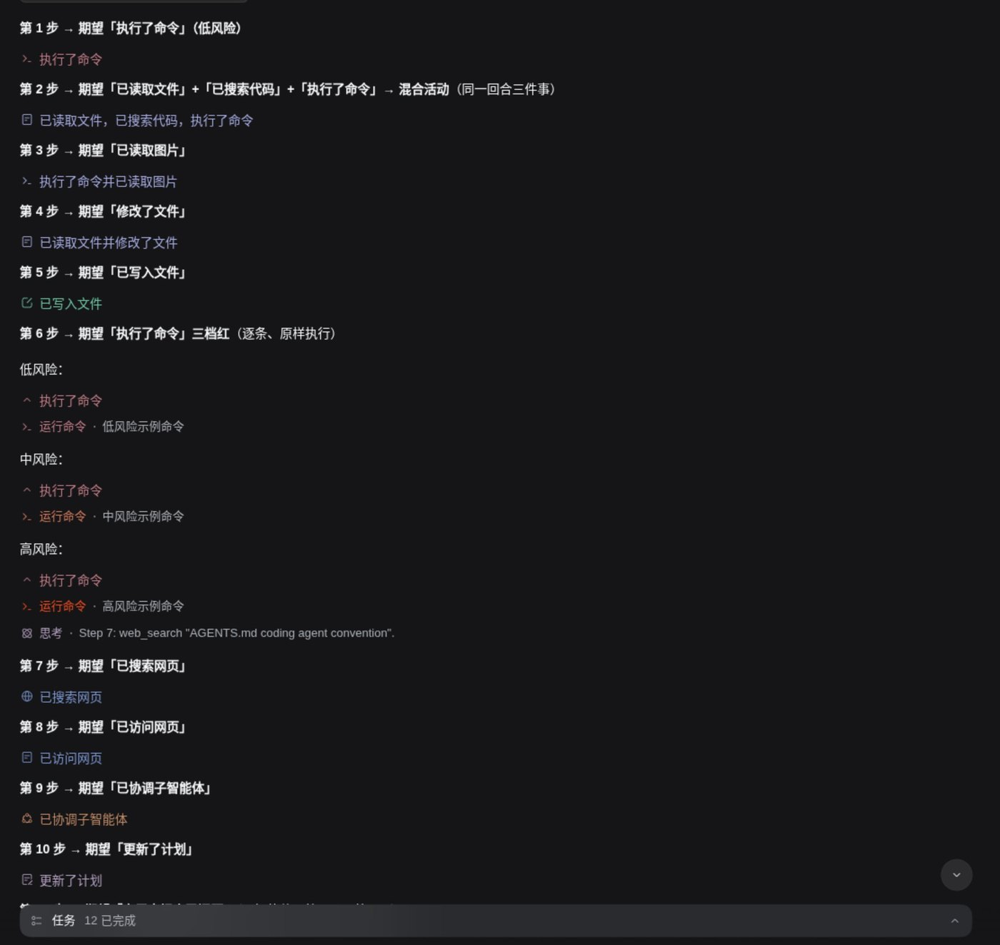
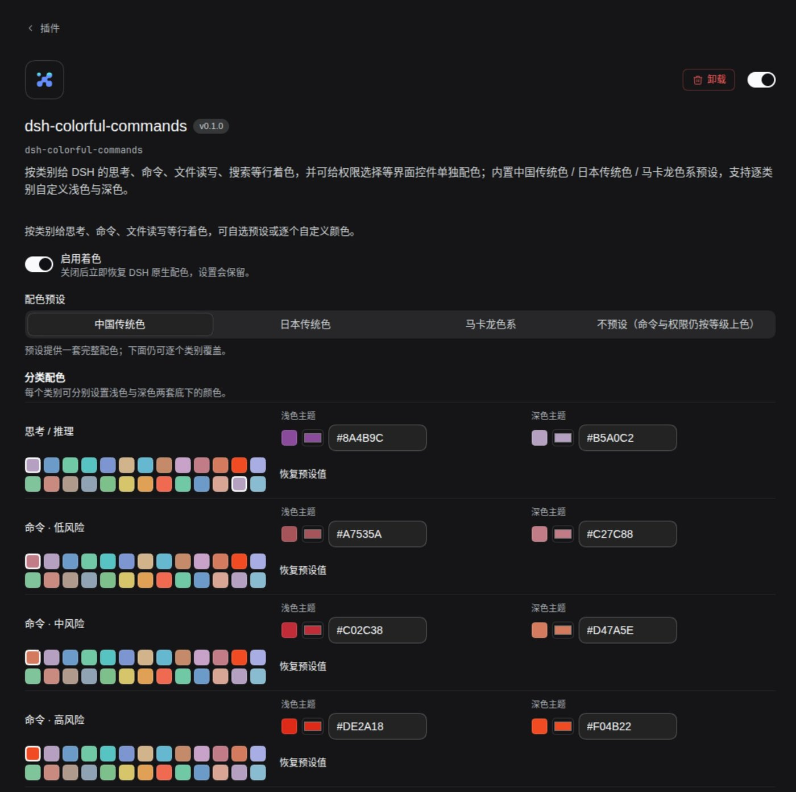
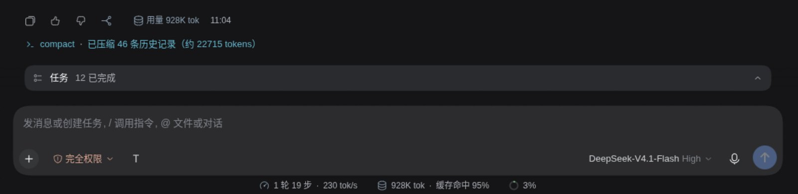

# dsh-colorful-commands

**Color the DeepSeek Harness interface by category** — thinking, commands (graded by risk), file reads and writes, search, web requests, other tools — plus the permission selector and plan-mode control near the composer.

Ships with **traditional-color presets** (Chinese traditional, 742 colors / Japanese traditional / Macaron) and lets you **customize every category** for light and dark themes. The palette is deliberately low-saturation and contrast-constrained, so **it stays easy on the eyes during long sessions**.

[中文](README.md) | English

> 🤖 **AI-generated notice**: this repository was produced by the AI coding agent
> **blancatora** (DeepSeek Harness / deepseek-v4.1-flash). It is **not** hand-written.
> It may contain errors or unverified claims — please verify before relying on it.

> 🤖 **For AI agents**: before changing this repo, read [AGENTS.md](AGENTS.md)
> (how to change it: verification commands, build artifacts, hard constraints,
> off-limits areas, repo-specific gotchas) and [llms.txt](llms.txt) (what it does,
> doc index, known limits). Humans can skip this line.

## What it colors

| Category | What gets colored |
|---|---|
| Thinking / reasoning | Reasoning rows, process-group titles |
| **Commands · low / mid / high** risk | `bash` / `pwsh` rows — graded by the **actual command text**, all three tiers in the red family with increasing saturation |
| File reads | `read`, image reads |
| Writes / edits | `write` / `edit` |
| Search | `grep` / `glob` |
| Web requests | `web_search` / `web_fetch` |
| Other tools | Unclassified tools (neutral color) |
| Status | “Done” success green, context-ring tiers, mixed-activity titles, tail usage / branch buttons |
| UI controls | Permission selector (recolors per level), plan mode |



*Real result in dark theme — one color per category: thinking purple, commands in three red
tiers by risk, reads and writes green, search teal, web indigo, mixed-activity groups in a
unified indigo, subagents and plan in neutral tones.*


## Presets and customization

| Preset | Library | |
|---|---|---|
| **Chinese traditional** (default) | 742 colors | Picked from the full traditional library by semantic hue; unified tone, low saturation |
| Japanese traditional | 58 colors | Lighter, quieter palette |
| Macaron | 34 colors | Pastel — the softest option |

Colors are **not hand-picked** — they are derived from a target hue, a unified tone, and
contrast against the real host background.

**Every category is customizable**: light and dark themes are set **separately**, via a
swatch picker or raw hex, with one-click reset to preset. Settings live on the
**plugin detail page** (see “Configure” below).



*The plugin detail page: switch presets at the top (Chinese traditional / Japanese traditional /
Macaron / none), and every category below has a light and a dark swatch row plus hex inputs,
with reset-to-preset available.*


## Why it's easy on the eyes

- **Low saturation first** — no neon, no high-saturation pure red or blue.
- **Separate light and dark palettes** — each theme has its own values instead of one color forced onto both.
- **Contrast is constrained** — every color's contrast against its background stays between
  **3.0 and 10.5**: too low is unreadable, too high is harsh. This bound is enforced by tests.
- **Only what should be colored gets colored** — icons, short labels and key statuses only;
  body text and reasoning output keep their native color. That avoids a wall of color,
  which is what actually tires your eyes.
- **Turn any category down** — if something feels harsh, override that category's
  light/dark value with a softer one.

## Status, usage and composer controls



*Only “usage” and “branch” are colored in the message tail (copy / like / dislike keep their
native grey). The “compacting” row, the context ring, and the permission / plan-mode controls
near the composer each get their own color too.*

## Install

> Currently distributed via **GitHub** (not yet published to npm), so install from the Git URL.

**Desktop**: Settings → Plugins → Add plugin, paste the URL below, then restart the app:

```
https://github.com/BlanCatOra/dsh-colorful-commands
```

**Web / CLI profile**:

```sh
dsh plugin --profile <profile> add https://github.com/BlanCatOra/dsh-colorful-commands
```

<sub>If it gets published to npm later, the bare package name `dsh-colorful-commands` will work too.</sub>

## Confirm it actually works in one minute

Paste the prompt from [docs/DEMO-PROMPT.md](docs/DEMO-PROMPT.md) into DSH and send it once.
It lights up every category that a prompt can trigger, and ships with an expected-color table.

## Configure

Sidebar → **Plugins → dsh-colorful-commands** (the plugin detail page). You can switch
presets, override each category's light / dark color (swatch or hex), and reset to preset.

> ⚠️ Plugin settings are **not** on the Settings page — DSH puts plugin config on the
> plugin's own detail page.

## The three command tiers

Grading uses the **actual command text** (read from the React fiber, not the model's
description) and matches danger words:

| Tier | Example triggers | Light |
|---|---|---|
| Low | ordinary commands | `#A7535A` |
| Mid | `sudo`, `curl`, `chmod -R`, `systemctl`, … | `#C02C38` |
| High | `rm -rf /`, `mkfs`, `dd of=/dev/`, `git push --force`, … | `#DE2A18` |

All three stay in the **red family**; only saturation increases with danger.

## Known limitations

- Colors the **client UI only** — it never changes behavior.
- Relies on the **stable suffix** of kernel CSS Module class names (e.g. `[class*="_title"]`).
  If the kernel renames those suffixes it stops working (the hash prefix changes every build,
  so only suffixes are matched).
- **Rows nested inside a process group** (e.g. “创建子智能体”, “更新任务清单”) only get their
  **icon** colored; the text stays at its native color — the kernel exposes no per-row
  semantic hook. See [AGENTS.md](AGENTS.md) §5.6.
- The `japanese` / `macaron` libraries are small, so a few categories have identical light and
  dark values (known defect; the list is frozen in the tests).

## Development

```sh
npm test     # = build + full test suite (one command)
```

`lib/client.js` is a build artifact and **is committed**; edit `src/` only, never the artifact.
Read [AGENTS.md](AGENTS.md) before changing anything.

## License

[MIT](LICENSE) © 2026 blancatora
